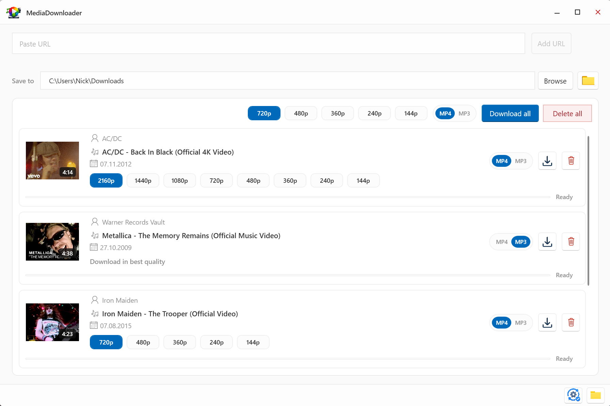

# MediaDownloader

MediaDownloader is a Windows desktop application built with WPF for analyzing media URLs and downloading video or audio content. The application uses yt-dlp for media extraction and FFmpeg for post-processing operations such as remuxing, merging, and MP3 conversion.



## Features

- Analyze media URLs with `yt-dlp`.
- Show media metadata such as title, author, thumbnail, duration, upload date, and available video qualities.
- Download video as MP4.
- Extract audio as MP3.
- Select output folder and open it from the app.
- Download or delete individual media items.
- Bulk download and bulk delete media items.
- Track download progress and post-processing state.
- Persist application settings and media list as XML.
- Check bundled tool versions and update `yt-dlp`, `ffmpeg`, and `ffprobe`.
- Build a Windows MSI installer with WiX Toolset.

## Tech Stack

- .NET 9
- WPF
- CommunityToolkit.Mvvm
- WPF-UI
- Microsoft.Extensions.DependencyInjection
- Serilog
- Polly
- xUnit.net v3
- WiX Toolset SDK

## Architecture

MediaDownloader is organized as a layered desktop application:

- The WPF application project owns startup, dependency injection, windows, and view models.
- The presentation project contains reusable UI resources and UI-facing utility abstractions.
- The services project contains application behavior that does not depend on WPF, such as media analysis, downloads, tool bootstrapping, XML persistence, and update checks.
- The logger project provides a small logging abstraction over Serilog.
- The installer project packages the built desktop application into an MSI.
- Test projects validate service logic and view model workflows without running real external tools or opening UI windows.

Dependencies are registered in `ServiceCollectionExtensions` and injected into view models and services through constructor injection. This keeps the UI workflow testable while isolating external concerns such as HTTP, file I/O, process execution, and popup dialogs behind small interfaces.

## Project Structure

```text
MediaDownloader/                 WPF application, views, and view models
MediaDownloader.Services/        yt-dlp, FFmpeg, download, XML, and update services
MediaDownloader.Presentation/    UI resources, controls, utilities, styles, and images
MediaDownloader.Logger/          Logging abstraction and Serilog wrapper
MediaDownloader.Installer/       WiX MSI installer project
MediaDownloader.Services.Tests/  Unit tests for service logic
MediaDownloader.Tests/           Unit tests for view model workflows
```

### MediaDownloader.Presentation

`MediaDownloader.Presentation` contains UI assets and reusable presentation infrastructure shared by the WPF application:

- localized `.resx` resources exposed through `ResourceWrapper`;
- image paths, common constants, icons, and application images;
- reusable WPF controls such as popup and tool-download progress windows;
- styles for buttons, text boxes, lists, and colors;
- UI utility abstractions and implementations for shell operations, folder selection, and popups.

Keeping this project separate from the main WPF app keeps view models focused on state and commands while presentation-specific resources and utilities stay in one place.

## Requirements

- Windows
- .NET 9 SDK
- WiX Toolset SDK 6.0.2 for MSI builds
- Internet access for first-time tool download and update checks

The app uses these external tools:

- `yt-dlp.exe`
- `ffmpeg.exe`
- `ffprobe.exe`

On startup, the app checks whether required tools are available and can download missing tools after user confirmation.

## Dependencies

Runtime packages:

- `CommunityToolkit.Mvvm` - observable properties and relay commands for view models.
- `Microsoft.Extensions.DependencyInjection` - application dependency injection.
- `WPF-UI` - WPF UI components and styling support.
- `Serilog` and `Serilog.Sinks.File` - application logging.
- `Polly.Core` - retry and timeout handling for tool downloads.

Test packages:

- `xunit.v3` - unit test framework.
- `Microsoft.NET.Test.Sdk` - .NET test execution support.

Installer dependency:

- `WixToolset.Sdk` - MSI package build support.

External tools used by the app:

- `yt-dlp.exe` - media metadata extraction and downloading.
- `ffmpeg.exe` - media processing, merging, remuxing, and audio extraction.
- `ffprobe.exe` - FFmpeg toolset companion executable.

## Build

From the repository root:

```powershell
dotnet build MediaDownloader\MediaDownloader.csproj
```

## Run

```powershell
dotnet run --project MediaDownloader\MediaDownloader.csproj
```

## Test

```powershell
dotnet test MediaDownloader\MediaDownloader.sln
```

Current test coverage includes service parsing and command-building logic, XML persistence behavior, tool bootstrap edge cases, and view model workflows.

## Build MSI

```powershell
dotnet build MediaDownloader.Installer\MediaDownloader.Installer.wixproj -c Release -p:Platform=x64
```

The x64 MSI is written to `MediaDownloader.Installer\bin\x64\Release\MediaDownloader.msi`.
Use that file as the GitHub Release asset. The installer project packages the main application output.
Test projects are not included in the MSI.

## Notes

- Application settings and saved media data are stored as XML in the app configuration folder.
- Downloads are performed by `yt-dlp`; FFmpeg is used for remuxing, merging, and audio extraction.
- Tool updates are checked against the configured release endpoints for `yt-dlp` and FFmpeg.
